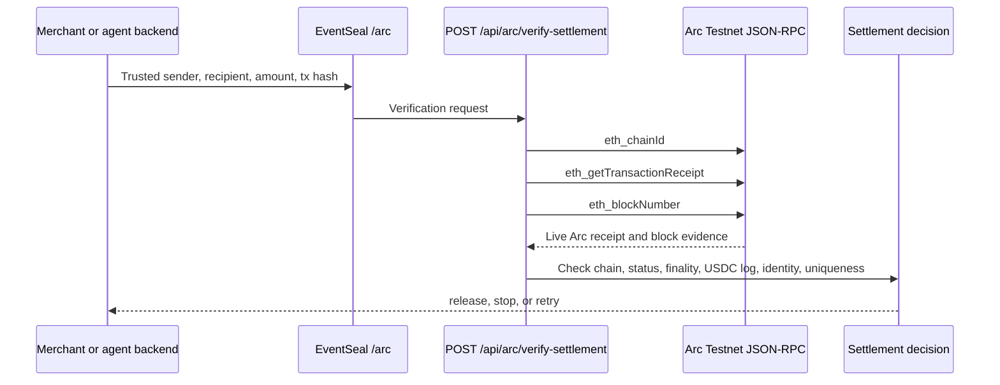

# Arc USDC settlement verification

EventSeal's Arc settlement gate protects a backend action with live Arc Testnet
evidence. A caller supplies the USDC payment terms it trusted before seeing the
transaction: transaction hash, sender, recipient, and exact amount. EventSeal
reads the transaction receipt from Arc JSON-RPC and returns one decision:

- `release` when exactly one successful, finalized canonical USDC
  transfer matches every trusted term;
- `stop` when committed evidence contradicts the request; or
- `retry` when the network, receipt, or transfer identity is
  unavailable or ambiguous.

The gate is deliberately read-only. It never asks for a wallet key and never
initiates a transfer.

## Architecture



The Arc-specific implementation lives in
[`apps/web/lib/arc-settlement-verifier.ts`](../apps/web/lib/arc-settlement-verifier.ts).
The public page is at `/arc`, and the server adapter is
`POST /api/arc/verify-settlement`.

## Network contract

| Property               | Value                                                                |
| ---------------------- | -------------------------------------------------------------------- |
| Network                | Arc Testnet                                                          |
| Chain ID               | `5042002` (`0x4cef52`)                                               |
| JSON-RPC               | `https://rpc.testnet.arc.network`                                    |
| USDC ERC-20 interface  | `0x3600000000000000000000000000000000000000`                         |
| USDC transfer decimals | 6                                                                    |
| Required confirmations | 1                                                                    |
| Transfer topic         | `0xddf252ad1be2c89b69c2b068fc378daa952ba7f163c4a11628f55a4df523b3ef` |

Arc emits the standard `Transfer(address,address,uint256)` event from
its canonical USDC interface for both native and ERC-20 USDC movements.
EventSeal filters only that contract and topic. It does not count the
corresponding 18-decimal native-balance log as another payment.

## Request

```http
POST /api/arc/verify-settlement
Content-Type: application/json
```

```json
{
  "transactionHash": "0xedaf47800669bd77029f6a779a3c2824a84e2e46385d45d53091a226e65769f0",
  "expectedSender": "0xe398777ab152fc44893415a731ceab226478f5ae",
  "expectedRecipient": "0xbbc2a38ab48fa953ec68ee6115bd518d3a226f6e",
  "expectedAmount": "8.388778"
}
```

Amounts are decimal strings. EventSeal converts them to 6-decimal integer base
units and never uses floating-point arithmetic.

## Release contract

A result with `decision: "release"` means all of these checks passed:

1. The configured RPC identified itself as Arc Testnet chain `5042002`.
2. A committed receipt exists and the current Arc block includes it.
3. The receipt reports successful EVM execution.
4. The receipt contains a non-removed standard `Transfer` log emitted
   by the canonical Arc USDC interface.
5. Sender, recipient, and 6-decimal amount match the trusted request exactly.
6. Exactly one transfer matches, so the settlement identity is unambiguous.

The issued `es_arc_<sha256>` receipt ID binds the network, transaction,
canonical USDC contract, log index, block, sender, recipient, and amount. The
current MVP returns this receipt in the response; persistence and replay
consumption remain the integrating application's responsibility.

```json
{
  "verdict": "verified",
  "decision": "release",
  "reasonCode": "VERIFIED",
  "network": "arc-testnet",
  "chainId": 5042002,
  "transactionHash": "0xedaf47800669bd77029f6a779a3c2824a84e2e46385d45d53091a226e65769f0",
  "receiptId": "es_arc_<sha256>",
  "transfer": {
    "sender": "0xe398777ab152fc44893415a731ceab226478f5ae",
    "recipient": "0xbbc2a38ab48fa953ec68ee6115bd518d3a226f6e",
    "amount": "8.388778",
    "amountBaseUnits": "8388778",
    "logIndex": 1,
    "blockNumber": 61899564
  }
}
```

Any `stop` or `retry` response must prevent fulfillment. A
verified onchain settlement is still only one input to the application's
authorization, sanctions, inventory, refund, and replay-protection rules.

## Run the live example

Start EventSeal and open `http://localhost:3000/arc`:

```bash
npm install
npm run dev
```

Click **Load live example**, then **Verify Arc settlement**. The example is a
public Arc Testnet transaction and the server fetches its current receipt; the
UI does not substitute fixture data. Unit and browser tests use injected RPC
and API responses so CI remains deterministic.

## Security boundary

- The RPC endpoint and canonical USDC contract are fixed server-side. Request
  input cannot select an arbitrary URL or token contract.
- A missing receipt, malformed response, wrong chain, RPC error, or duplicate
  exact transfer returns `retry`; none can become `release`.
- A reverted transaction or mismatched sender, recipient, or amount returns
  `stop`.
- Request bodies are JSON-only, size-limited, and validated before the RPC call.
- EventSeal uses no private keys, wallet seeds, administrative credentials, or
  client-side direct RPC calls in this flow.

Arc is currently a testnet. Recheck Arc's published chain ID, RPC endpoint,
canonical USDC address, and mainnet deployment details before moving this gate
to Arc Mainnet.

## Arc references

- [Arc Testnet RPC endpoints and chain parameters](https://docs.arc.io/arc/references/rpc-endpoints)
- [Arc Testnet contract addresses](https://docs.arc.io/arc/references/contract-addresses)
- [Arc USDC deposit detection and deterministic finality](https://docs.arc.io/integrate/exchanges/deposits)
